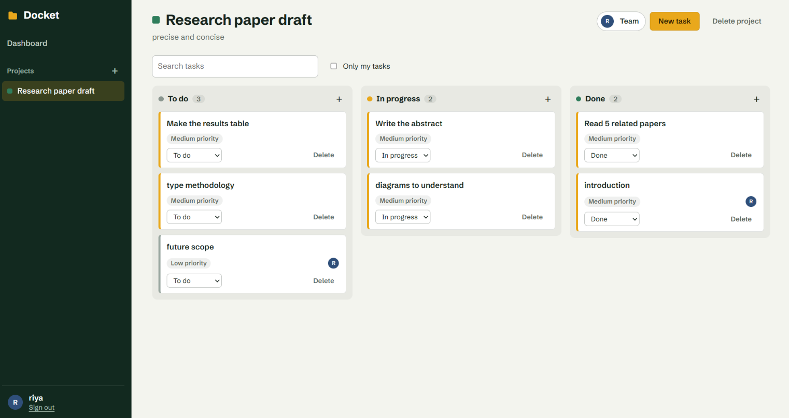

# Docket

A full-stack project management app for small teams. Create projects, invite teammates by email, and move tasks across a shared board.

   **Live demo:** https://docket-project-manager.onrender.com

> The demo runs on a free server that sleeps when nobody is using it, so the first load can take up to a minute. Anyone can sign up, so please use made-up details and never a real password.



## What it does

- Sign up and sign in. Passwords are hashed, and login uses a signed token (JWT).
- A dashboard with one card per project and a progress bar showing how many tasks are done.
- A project board with three columns: To do, In progress and Done.
- Create, edit and delete tasks. Each task has a priority, an optional due date and an optional assignee.
- Change a task's status straight from its card. The card moves immediately and goes back if the server refuses.
- Teams: the project owner adds people by email (they must already have an account) and can remove them.
- Search tasks, or show only the tasks assigned to you.
- Loading states, clear error messages with a retry button, and empty states.
- Access control: you can only open projects you belong to.

## Built with

| Part | Technology |
| --- | --- |
| Frontend | React, TypeScript, Vite, React Router, plain CSS |
| Backend | Python, FastAPI, SQLAlchemy, Pydantic |
| Database | PostgreSQL |
| Auth | bcrypt (password hashing), PyJWT (login tokens) |
| Tests | pytest (backend), Vitest (frontend helpers) |
| Tooling | Docker, Docker Compose, GitHub Actions |

## Run it on your own computer

You need [Docker Desktop](https://www.docker.com/products/docker-desktop/).

1. Copy `.env.example` to a new file named `.env`.
2. Put your own values in it. To make a random secret key, run:

   ```bash
   python -c "import secrets; print(secrets.token_hex(32))"
   ```

   Use one value for `SECRET_KEY` and a different one for `POSTGRES_PASSWORD`. The `.env` file is ignored by Git, so it is never uploaded.
3. Start everything:

   ```bash
   docker compose up --build
   ```

4. Open http://localhost:8080. The API documentation is at http://localhost:8000/api/docs.

Stop it with `Ctrl+C`. To also erase the stored data, run `docker compose down -v`.

## Run the tests

```bash
cd backend
pip install -r requirements-dev.txt
pytest
```

```bash
cd frontend
npm install
npm test
npm run build   # also type-checks the code
```

The backend tests use a temporary SQLite file, so they do not need PostgreSQL. GitHub Actions runs both test suites and a build on every push.

## API overview

Every route starts with `/api`. Apart from register and login, requests need the header `Authorization: Bearer <token>`.

| Method | Path | What it does |
| --- | --- | --- |
| POST | `/auth/register` | Create an account and get a token |
| POST | `/auth/login` | Sign in and get a token |
| GET | `/auth/me` | Get the signed-in user |
| GET, POST | `/projects` | List your projects, or create one |
| GET, PATCH, DELETE | `/projects/{id}` | Read a project, rename it (owner), delete it (owner) |
| POST | `/projects/{id}/members` | Add a person by email (owner) |
| DELETE | `/projects/{id}/members/{user_id}` | Remove a person (owner) |
| GET, POST | `/projects/{id}/tasks` | List or create tasks |
| PATCH, DELETE | `/tasks/{id}` | Edit or delete a task |

## How the code is organised

```
backend/
  app/
    main.py         app setup and CORS; creates the tables on start
    database.py     connection to PostgreSQL
    models.py       users, projects, tasks and project members
    schemas.py      the JSON the API accepts and returns
    security.py     password hashing and tokens
    deps.py         "who is signed in?" and "may they see this project?"
    routers/        auth.py, projects.py, tasks.py
  tests/            API tests
frontend/
  src/
    api.ts          every call to the backend, in one place
    auth.tsx        sign-in state shared across the app
    projects.tsx    the project list shared by the sidebar and dashboard
    pages/          sign-in, dashboard and project board
    components/     sidebar, cards, task and team dialogs
    lib/            small helper functions and their tests
docker-compose.yml  database, backend and website together
```

## Design decisions

- **Strangers get a 404, not a 403.** Asking for someone else's project says "not found", so nobody can discover which project ids exist.
- **The owner is also stored as a member.** One rule, "are you a member?", controls all access.
- **Status changes are optimistic.** The screen updates first and rolls back if the request fails, so the board feels instant.
- **Secrets stay out of the code.** The signing key and database password come from environment variables, and `.env` is ignored by Git.

## Limitations and next steps

- Tables are created when the server starts. A larger app would use migrations (for example Alembic).
- The login token is kept in `localStorage`. Cookies that JavaScript cannot read would be safer for a production app.
- No email verification or password reset yet.
- Tasks cannot be dragged between columns yet; status is changed with the dropdown.


